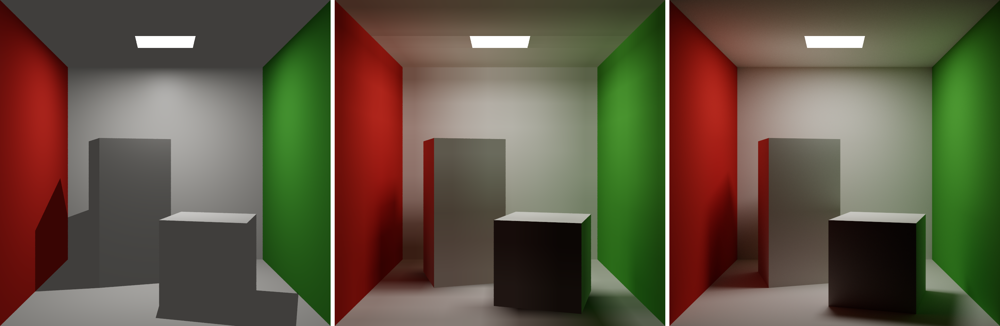
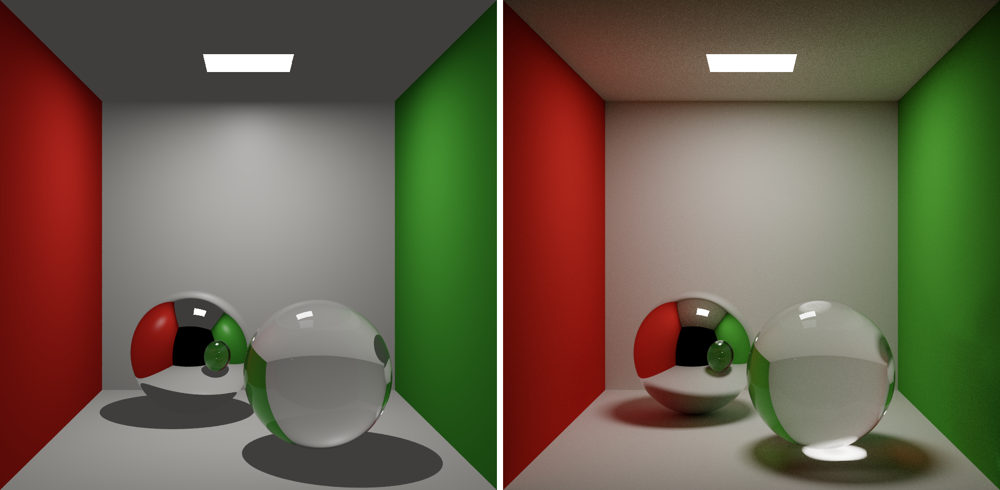
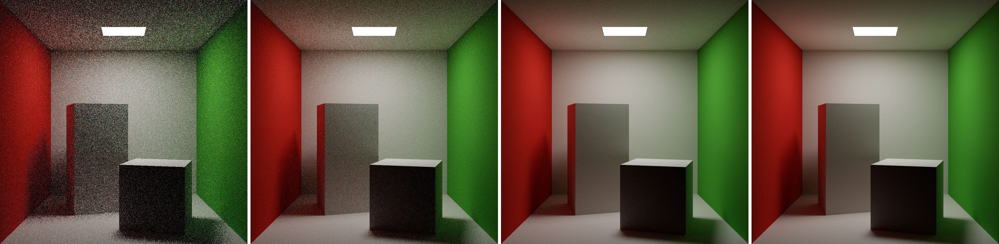
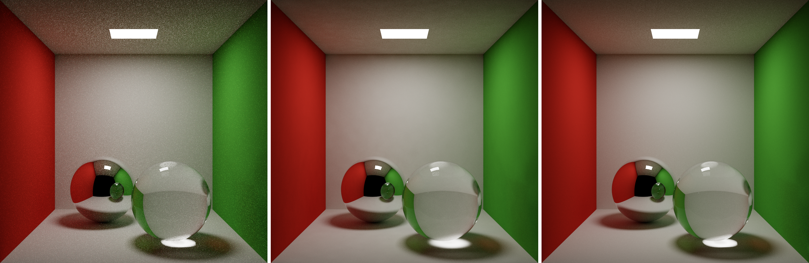
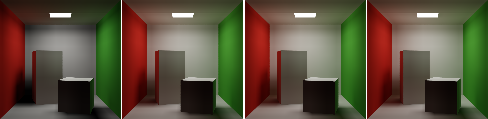

<div align="center">

# Cornell Box GI

**An interactive WebGL2 viewer that renders the Cornell box with four illumination methods so they can be compared on the same scene.**

[](https://registry.khronos.org/webgl/specs/latest/2.0/)
[](https://registry.khronos.org/OpenGL/specs/es/3.0/GLSL_ES_Specification_3.00.pdf)
[](https://developer.mozilla.org/docs/Web/JavaScript)
[](https://svelte.dev)
[](https://vite.dev)
[](https://vitest.dev)
[](https://pnpm.io)
[](https://nodejs.org)
[](LICENSE)



<sub>The measured Cornell box: Phong (left), radiosity (centre) and path tracing at 4096 samples per pixel (right).</sub>

</div>

## Overview

Cornell Box GI renders the measured [Cornell box](https://bowers.cornell.edu/cornell-box) with
**Phong local illumination**, **Whitted ray tracing**, **path tracing** and **radiosity**. Geometry,
materials and camera stay the same, so the only thing that changes is the method. Every algorithm
is hand-written in GLSL and runs on the GPU in real time. There is no rendering library and no
backend.

It was built as the graphics application for the report _Modelos de iluminación global_
(Computación Visual, Universidad Nacional Mayor de San Marcos). The automated tests reproduce the
report's worked examples.

## Features

- **Four illumination methods** with progressive refinement: each frame adds samples to a
  floating-point accumulation buffer.
- **Two scenes**:
  - the measured Cornell box with its two blocks;
  - the same room with a mirror sphere and a glass sphere.
- **Photon-mapped caustics** that make the light focused by the glass sphere converge in seconds.
- **Two-pass radiosity + ray tracing** for the specular scene.
- **Split screen** to compare two methods with the same camera, using a draggable divider.
- **Ray inspector** that draws the Whitted ray tree of any pixel over the image.
- **Radiosity convergence playback**: step through Jacobi, Gauss-Seidel or progressive refinement
  one iteration at a time.
- **Adaptive sampling** that measures the GPU and fits as many samples per frame as it can at
  about 30 fps.
- **Path tracing quality presets** (256, 1k, 4k and 16k samples per pixel) and PNG export cropped
  to the scene.
- **English and Spanish interface**.

## Methods

| Method                | Light paths captured | Implementation highlights                                                                           |
| --------------------- | -------------------- | --------------------------------------------------------------------------------------------------- |
| Phong (local)         | LDE, LSE             | Shadow ray to the area light, constant ambient term                                                 |
| Whitted ray tracing   | LDS\*E \| LS\*E      | Explicit ray stack instead of recursion, exact Fresnel, Snell refraction, total internal reflection |
| Path tracing          | L(D\|S)\*E           | Next event estimation, cosine-weighted sampling, Russian roulette, no double-counted emission       |
| Radiosity             | LD\*E                | Exact point-to-polygon form factors, Jacobi / Gauss-Seidel / progressive solvers in a Web Worker    |
| Photon map (caustics) | LS⁺DE                | Photons traced from the light in a Web Worker, density estimate on per-surface grids                |

Path notation after Heckbert (1990): L = light, D = diffuse bounce, S = specular bounce, E = eye.

## Screenshots

|                                            Whitted vs. path tracing                                             |                                           Path tracing convergence                                           |
| :-------------------------------------------------------------------------------------------------------------: | :----------------------------------------------------------------------------------------------------------: |
|     |      |
|                   Hard shadows and no caustic vs. soft shadows and a caustic under the glass                    |                          1, 16, 256 and 4096 samples per pixel: noise falls as 1/√N                          |
|                                           **Photon-mapped caustics**                                            |                                          **Radiosity convergence**                                           |
|  |  |
|                        Path tracing vs. photon map at 256 spp, and a 4096 spp reference                         |                                 Gauss-Seidel after 1, 3, 8 and 24 iterations                                 |

More captures are in [`docs/captures`](docs/captures).

## Getting started

### Requirements

- [Node.js](https://nodejs.org) 20 or newer
- [pnpm](https://pnpm.io) 11
- A browser with WebGL2 and float render targets (`EXT_color_buffer_float`): any recent Chrome,
  Edge, Firefox or Safari

### Install and run

```bash
git clone https://github.com/angelariasus/cornell-box-gi.git
cd cornell-box-gi
pnpm install
pnpm dev
```

Open http://localhost:5173. Use `pnpm dev --host` to try it from another device on the same
network.

### Scripts

| Command           | Description                                   |
| ----------------- | --------------------------------------------- |
| `pnpm dev`        | Development server with hot reload            |
| `pnpm build`      | Production build into `dist/` (a static site) |
| `pnpm preview`    | Serve the production build locally            |
| `pnpm test`       | Run the test suite once                       |
| `pnpm test:watch` | Run the tests in watch mode                   |
| `pnpm format`     | Format the code with Prettier                 |

## Usage

| Input                                  | Action                                   |
| -------------------------------------- | ---------------------------------------- |
| Drag on the image                      | Orbit the camera                         |
| Mouse wheel / pinch                    | Zoom                                     |
| Click (Whitted, ray inspector enabled) | Trace and draw the rays of that pixel    |
| Drag the ⇆ handle                      | Move the split screen divider            |
| Camera button over the canvas          | Return to the camera of the Cornell data |

Buttons over the top right of the canvas reset the camera, restart the accumulation and save a PNG;
the bottom left shows the samples per pixel, a progress bar and the frame time. The side panel has
the scene, the method and collapsible sections for the settings of each method, caustics, split
screen, display options (exposure, white balance, resolution scale), advanced options and detailed
statistics. The [user manual](docs/manual.md) explains every setting and lists experiments to try.

For benchmarks on other machines, the browser console exposes the renderer:

```js
viewer.benchmark(20); // GPU milliseconds per pass of the current method
await viewer.accumulate(4096); // accumulate 4096 samples as fast as possible
```

## How it works

```
Svelte stores ──► renderer.js ──► method shader ──► RGBA32F accumulation (ping-pong)
                       │                                       │
   radiosity worker ───┤ patch irradiance (float texture)      ▼
   photon worker ──────┘ caustic irradiance (float texture)   display.frag: exposure,
                                                              white balance, ACES, sRGB
```

- **Rendering.** A full-screen triangle runs one fragment shader per method. Each pixel casts its
  ray against an analytic scene of quads and spheres. Bounding boxes around the blocks let rays
  skip five quads at a time.
- **Accumulation.** Each pass adds k samples per pixel to a float buffer. The renderer measures
  the GPU cost of one sample and chooses k to fill about 31 ms per frame.
- **Display.** White balance to the measured light (von Kries), ACES tone mapping and sRGB output.
  This step is the same for every method, so the images can be compared directly.
- **Radiosity.** Patches, form factors and solvers run in a Web Worker. Rows are symmetrized for
  reciprocity and clamped so no patch sends out more light than it receives. The shader reads the
  irradiance of each patch, bilinearly interpolated for smooth shading.
- **Scene data.** Geometry, reflectances and light emission come from the
  [Cornell Box Data](https://bowers.cornell.edu/computer-graphics/data), normalized by 555 mm.
  The official camera is at (278, 273, −800) with a 39.31° vertical field of view.

## Verification

The test suite (114 tests, Node only) reproduces the report:

- **Example 2:** the ray–sphere intersection, shadow ray, reflection and refraction, step by step.
- **Table 2:** all 54 Jacobi and Gauss-Seidel values, to two decimals.
- **Form factors:** checked against analytic values for parallel and perpendicular squares and
  a closed cube.
- **Photon map:** checked for energy conservation and against the analytic direct light.

Measured in the browser:

| Check                                                           | Result        |
| --------------------------------------------------------------- | ------------- |
| Radiosity / path tracing brightness (8 and 14 patches per unit) | 0.985 / 0.994 |
| Photon-mapped caustics (256 spp) / path tracing (4096 spp)      | 1.002         |
| Mean brightness with / without next event estimation            | 0.999         |
| Radiosity solve time (384 patches)                              | 0.2 s         |
| Photon map, 500,000 photons                                     | 0.22 s        |

Timings were measured on an integrated Intel GPU.

## Project structure

```
src/
├─ App.svelte         layout and wiring between stores, renderer and workers
├─ i18n/              English and Spanish texts
├─ ui/                control panel, canvas overlays, split divider, ray inspector
├─ state/             Svelte stores and the radiosity / caustics controllers
├─ scene/             Cornell box data, materials and shader packing
├─ math/              vector math, random numbers, Whitted ray tree
├─ render/            WebGL2 renderer, camera and GLSL shaders
├─ radiosity/         patches, form factors, solvers, worker
└─ photons/           caustic photon tracing, worker
tests/                Vitest suites
docs/                 manual, captures
```

## Documentation

- [User manual](docs/manual.md): every control, things to try and how the renderer works.

## Limitations

- Scenes are made of quads and spheres only. There are no mesh files and no textures.
- Materials are limited to Lambertian, ideal mirror and ideal dielectric.
- On an integrated GPU, path tracing needs about a minute to reach 4096 samples per pixel at
  1000 × 1000.
- The two-pass method ignores light that the spheres send back to the walls, so it is about 10%
  darker than path tracing.

## Acknowledgements

- Scene data: Cornell Ann S. Bowers College of Computing and Information Science,
  [Cornell Box Data](https://bowers.cornell.edu/computer-graphics/data).
- Interface icons: [Hugeicons](https://hugeicons.com) free set (MIT).
- Methods follow Whitted (1980), Goral et al. (1984), Cohen et al. (1988), Kajiya (1986),
  Heckbert (1990), Jensen (1996) and Pharr, Jakob & Humphreys,
  [_Physically Based Rendering_](https://pbr-book.org/) (4th ed., 2023).

## Author

[@angelariasus](https://github.com/angelariasus)

## License

Released under the [MIT License](LICENSE).
